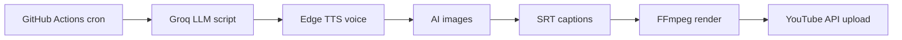

# YouTube Shorts Bot

Fully automated Shorts pipeline: **Groq script → Edge TTS voice → AI images → captions → FFmpeg → YouTube upload**, running daily on GitHub Actions at ~$0 cost.


## Architecture


## Tech Stack
Python, Groq API, Edge TTS, HuggingFace Inference, FFmpeg, YouTube Data API v3, GitHub Actions

## Quick Start
```bash
git clone https://github.com/Manideep71234/YT_BOT
cd YT_BOT
python3 -m venv .venv && .venv/bin/pip install -r requirements.txt
cp .env.example .env   # GROQ_API_KEY, HF_TOKEN
.venv/bin/python scripts/run_short.py --channel ghost_stories
```
Output: `output/runs/<channel>_<timestamp>/short.mp4`

Upload: run `scripts/youtube_auth.py` once, then add `--upload --privacy private`.

## Channel Presets
`ghost_stories`, `facts`, `school_story`, `psych_tradeoff`, `history_micro` (add more in `pipeline/channel_presets.py`).

## Daily Automation
GitHub Actions runs `daily_short.yml` at 10:00 UTC. Add secrets: `GROQ_API_KEY`, `HF_TOKEN`, `YT_CLIENT_ID`, `YT_CLIENT_SECRET_VALUE`, `YT_REFRESH_TOKEN`.


## Results


## Cost
Groq, HuggingFace, Edge TTS, FFmpeg, YouTube API: free tier. Total ≈ $0/day.
